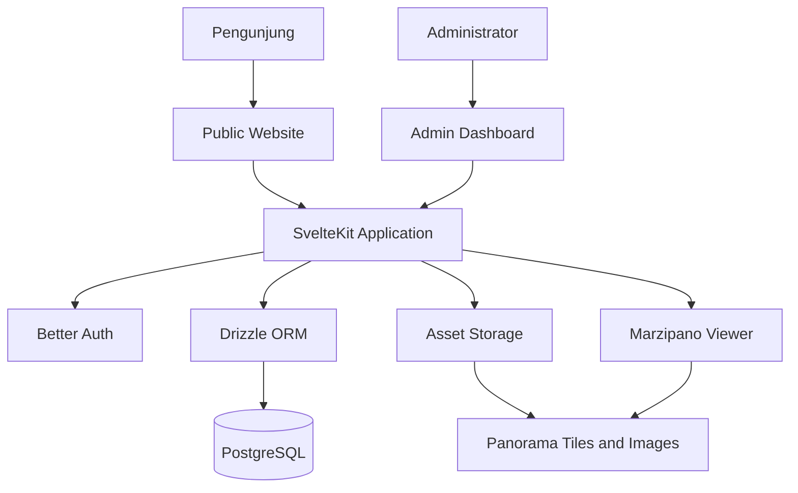
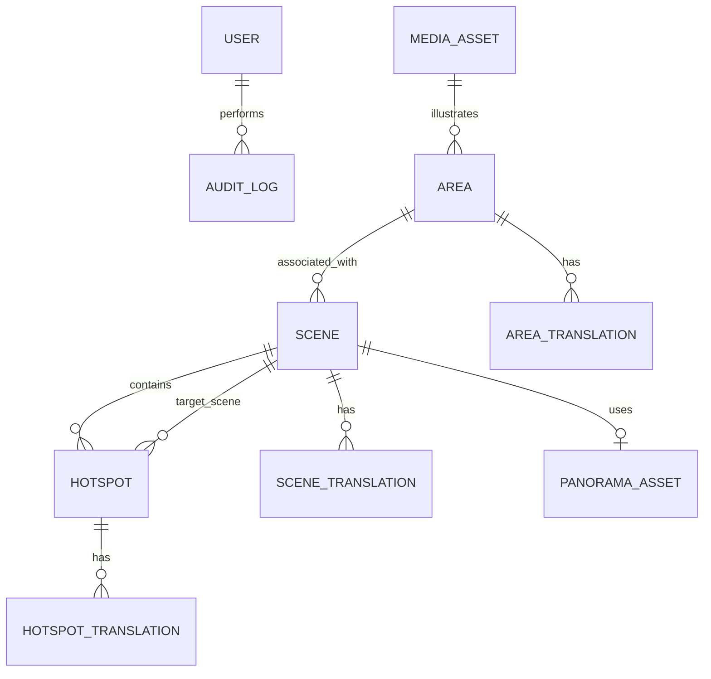
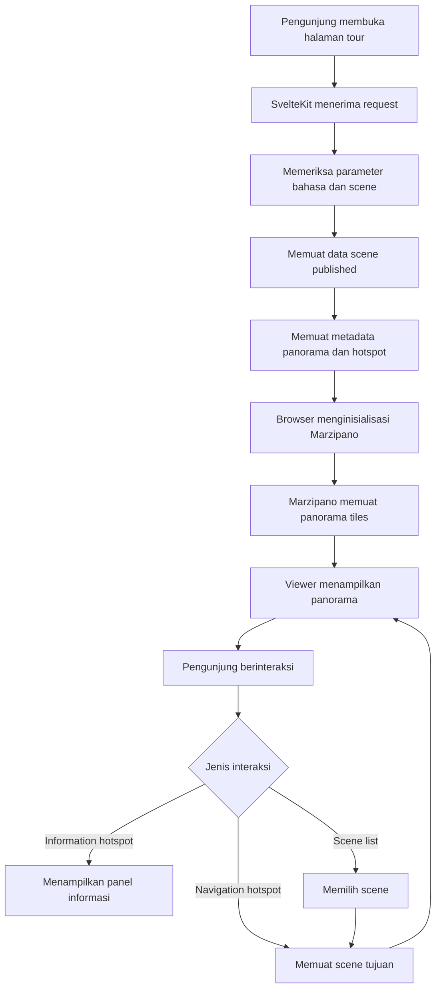
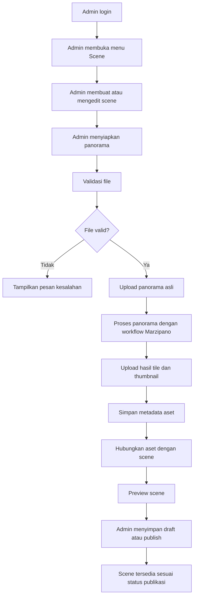
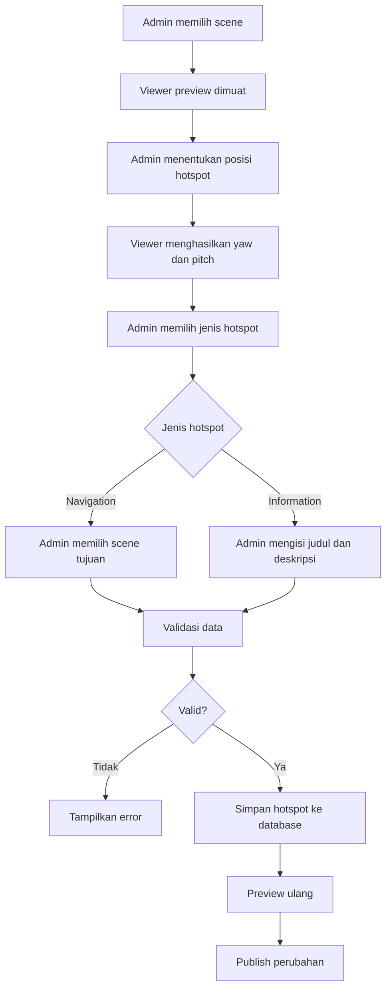
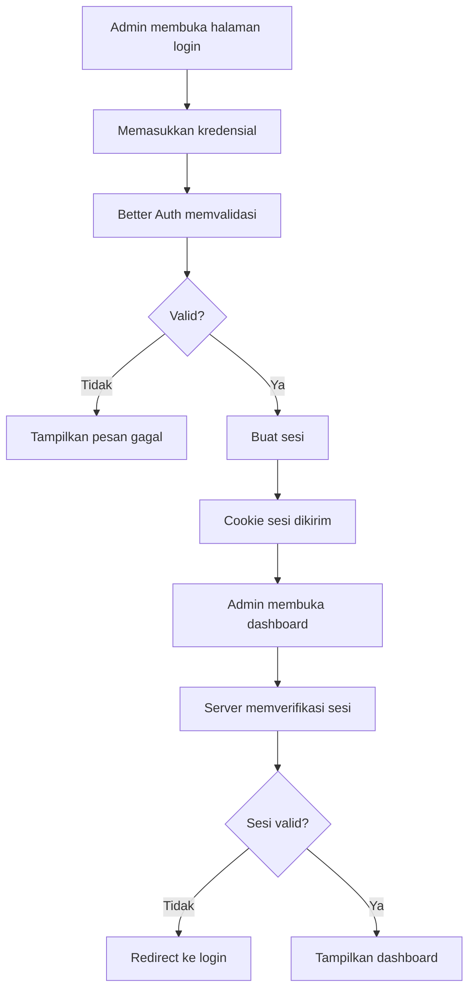

# Dokumen Perancangan Produk

## Pura Batuan Kaler 360

**Jenis dokumen:** Product Requirements Document (PRD), UI/UX Design
Specification, dan Data Flow\
**Versi:** 1.0\
**Tanggal:** 9 November 2026\
**Status:** Draft untuk validasi dan implementasi tahap awal

------------------------------------------------------------------------

# 1. Ringkasan Proyek

## 1.1 Gambaran Umum

Pura Batuan Kaler 360 adalah platform digital berbasis web yang
menyediakan pengalaman eksplorasi virtual terhadap kawasan Pura Batuan
Kaler melalui panorama 360 derajat. Pengunjung dapat menjelajahi
beberapa titik atau area pura, berpindah antarlokasi melalui hotspot,
melihat informasi mengenai area tertentu, serta mengakses panduan
kunjungan.

Platform menyediakan dua sisi aplikasi:

1.  **Public website**, yaitu antarmuka yang digunakan pengunjung untuk
    melihat informasi dan menjelajahi virtual tour.
2.  **Admin dashboard**, yaitu antarmuka pengelolaan konten yang
    digunakan oleh satu administrator utama untuk mengelola panorama,
    scene, hotspot, dan informasi pendukung.

Proyek menggunakan Marzipano sebagai engine panorama. Marzipano bertugas
merender panorama dan menyediakan mekanisme interaksi 360 derajat.
Pengelolaan konten, autentikasi, navigasi situs, dan tampilan antarmuka
dibangun di dalam aplikasi SvelteKit.

## 1.2 Tujuan Produk

-   Menyediakan pengalaman virtual tour kawasan pura yang mudah
    digunakan melalui browser.
-   Mendokumentasikan area dan informasi pura dalam bentuk digital.
-   Memungkinkan pengunjung berpindah dari satu titik panorama ke titik
    lainnya.
-   Menyediakan informasi kontekstual melalui hotspot dan panel
    informasi.
-   Memungkinkan administrator mengelola konten tanpa harus mengubah
    kode aplikasi.
-   Menyediakan antarmuka berbahasa Indonesia dan Inggris.
-   Menjaga performa agar pengalaman tetap layak digunakan pada
    perangkat desktop maupun seluler.

## 1.3 Sasaran Pengguna

  -----------------------------------------------------------------------
  Pengguna                            Kebutuhan utama
  ----------------------------------- -----------------------------------
  Pengunjung umum                     Menjelajahi area pura dan memahami
                                      informasi yang tersedia

  Wisatawan                           Mendapatkan gambaran lokasi dan
                                      panduan kunjungan

  Pelajar dan peneliti                Mengakses dokumentasi visual dan
                                      informasi area

  Administrator                       Mengelola panorama, scene, hotspot,
                                      dan konten situs
  -----------------------------------------------------------------------

## 1.4 Prinsip Produk

-   **Respectful:** informasi dan visual harus menghormati nilai adat,
    agama, serta aturan pengelola pura.
-   **Accessible:** antarmuka mudah digunakan melalui desktop dan
    perangkat seluler.
-   **Informative:** setiap informasi harus jelas, terverifikasi, dan
    memiliki konteks.
-   **Performance-oriented:** panorama harus dimuat secara bertahap agar
    tidak membebani koneksi.
-   **Maintainable:** data konten dipisahkan dari komponen antarmuka dan
    kode aplikasi.
-   **Secure:** dashboard admin tidak menyediakan pendaftaran publik.

------------------------------------------------------------------------

# 2. Ruang Lingkup Produk

## 2.1 Fitur Public Website

  -----------------------------------------------------------------------
  ID                Fitur             Deskripsi         Prioritas
  ----------------- ----------------- ----------------- -----------------
  PUB-01            Beranda           Menampilkan       Must
                                      pengenalan pura,  
                                      hero image, dan   
                                      pintasan virtual  
                                      tour              

  PUB-02            Virtual tour      Menampilkan       Must
                                      panorama 360      
                                      derajat dalam     
                                      beberapa scene    

  PUB-03            Navigasi scene    Memungkinkan      Must
                                      pengunjung        
                                      berpindah         
                                      antarscene        

  PUB-04            Hotspot navigasi  Menampilkan titik Must
                                      interaksi untuk   
                                      berpindah scene   

  PUB-05            Hotspot informasi Menampilkan       Must
                                      informasi         
                                      mengenai area     
                                      atau objek        
                                      tertentu          

  PUB-06            Daftar lokasi     Menampilkan       Should
                                      daftar scene yang 
                                      tersedia          

  PUB-07            Mini-map          Menampilkan       Could
                                      representasi      
                                      posisi atau       
                                      hubungan          
                                      antarlokasi       

  PUB-08            Sejarah           Menampilkan       Should
                                      informasi sejarah 
                                      pura              

  PUB-09            Informasi area    Menampilkan       Should
                                      deskripsi area    
                                      atau bangunan     

  PUB-10            Galeri            Menampilkan       Could
                                      dokumentasi foto  

  PUB-11            Panduan kunjungan Menampilkan       Should
                                      informasi         
                                      kunjungan dan     
                                      ketentuan         

  PUB-12            Bahasa            Menyediakan       Should
                                      bahasa Indonesia  
                                      dan Inggris       
  -----------------------------------------------------------------------

## 2.2 Fitur Admin Dashboard

  -----------------------------------------------------------------------
  ID                Fitur             Deskripsi         Prioritas
  ----------------- ----------------- ----------------- -----------------
  ADM-01            Login admin       Autentikasi       Must
                                      administrator     

  ADM-02            Dashboard         Ringkasan jumlah  Should
                                      scene, hotspot,   
                                      dan status konten 

  ADM-03            Kelola scene      Membuat, melihat, Must
                                      mengubah, dan     
                                      menghapus scene   

  ADM-04            Kelola panorama   Mengunggah dan    Must
                                      menghubungkan     
                                      aset panorama ke  
                                      scene             

  ADM-05            Kelola hotspot    Membuat dan       Must
                                      mengubah posisi   
                                      serta jenis       
                                      hotspot           

  ADM-06            Kelola informasi  Mengelola judul,  Must
                                      deskripsi, dan    
                                      konten informasi  

  ADM-07            Status publikasi  Mengatur konten   Should
                                      sebagai draft     
                                      atau published    

  ADM-08            Pratinjau         Melihat scene dan Should
                                      hotspot sebelum   
                                      dipublikasikan    

  ADM-09            Pengaturan bahasa Mengelola konten  Should
                                      bahasa Indonesia  
                                      dan Inggris       

  ADM-10            Audit log         Mencatat          Could
                                      aktivitas penting 
                                      administrator     
  -----------------------------------------------------------------------

## 2.3 Di Luar Ruang Lingkup MVP

Fitur berikut tidak menjadi target implementasi awal:

-   Registrasi akun pengunjung.
-   Multi-role administrator dan sistem persetujuan berjenjang.
-   Komentar, ulasan, dan interaksi sosial.
-   Pemrosesan panorama otomatis berbasis antrean pekerjaan.
-   Aplikasi Android atau iOS native.
-   Analitik pengunjung tingkat lanjut.
-   Integrasi pembayaran atau pemesanan tiket.

Fitur di luar ruang lingkup dapat dipertimbangkan setelah MVP berjalan
dan kebutuhan operasional telah divalidasi.

------------------------------------------------------------------------

# 3. Persyaratan Fungsional

## 3.1 Public Website

### FR-PUB-01: Menampilkan Beranda

Sistem harus menampilkan halaman beranda yang memuat:

-   Identitas Pura Batuan Kaler 360.
-   Gambar utama atau hero image.
-   Ringkasan pengenalan pura.
-   Tombol menuju virtual tour.
-   Ringkasan informasi sejarah dan area.
-   Navigasi ke halaman informasi lainnya.

### FR-PUB-02: Menampilkan Virtual Tour

Sistem harus dapat:

-   Memuat panorama 360 derajat.
-   Mendukung interaksi drag pada desktop.
-   Mendukung interaksi sentuh pada perangkat seluler.
-   Menyediakan kontrol zoom.
-   Menyediakan mode layar penuh jika didukung browser.
-   Menampilkan indikator pemuatan ketika aset panorama belum selesai
    dimuat.

### FR-PUB-03: Navigasi Antarscene

Sistem harus menyediakan mekanisme perpindahan scene melalui hotspot
atau daftar lokasi. Ketika pengunjung memilih scene tujuan, viewer harus
berpindah ke panorama yang sesuai.

### FR-PUB-04: Menampilkan Informasi Hotspot

Hotspot informasi harus dapat membuka panel atau popover yang berisi
judul, deskripsi, dan media pendukung jika tersedia.

### FR-PUB-05: Konten Multibahasa

Konten yang dipublikasikan harus dapat ditampilkan dalam bahasa
Indonesia dan Inggris. Jika terjemahan tidak tersedia, sistem harus
menerapkan kebijakan fallback yang konsisten.

## 3.2 Admin Dashboard

### FR-ADM-01: Autentikasi

-   Hanya administrator yang telah dibuat atau diundang secara
    terkontrol yang dapat masuk.
-   Registrasi publik dinonaktifkan.
-   Halaman admin harus dilindungi oleh pemeriksaan sesi pada server.
-   Pengguna yang belum terautentikasi harus diarahkan ke halaman login.

### FR-ADM-02: Manajemen Scene

Administrator dapat:

-   Membuat scene.
-   Mengubah nama, slug, deskripsi, dan urutan scene.
-   Memilih aset panorama.
-   Menentukan status draft atau published.
-   Menghapus scene dengan pemeriksaan relasi hotspot.

### FR-ADM-03: Manajemen Hotspot

Administrator dapat:

-   Membuat hotspot pada scene.
-   Menentukan jenis hotspot.
-   Menentukan koordinat yaw dan pitch.
-   Menghubungkan hotspot navigasi dengan scene tujuan.
-   Mengisi konten untuk hotspot informasi.
-   Mengubah dan menghapus hotspot.

### FR-ADM-04: Manajemen Aset Panorama

Sistem harus menyimpan metadata aset panorama dan lokasi penyimpanannya.
Untuk MVP, pemrosesan gambar dapat dilakukan menggunakan alur kerja
eksternal seperti Marzipano Tool. Hasil pemrosesan kemudian diunggah ke
penyimpanan aset dan direferensikan oleh scene.

**Catatan:** Marzipano Tool bukan pemroses otomatis yang secara langsung
menyediakan seluruh alur unggah dan publikasi dari dashboard.
Otomatisasi pemrosesan dapat dikembangkan pada fase berikutnya.

------------------------------------------------------------------------

# 4. Persyaratan Nonfungsional

  -----------------------------------------------------------------------
  Kategori                            Persyaratan
  ----------------------------------- -----------------------------------
  Performance                         Halaman publik harus memuat aset
                                      secara bertahap dan menghindari
                                      pemuatan seluruh panorama sekaligus

  Responsive                          Layout harus mendukung desktop,
                                      tablet, dan ponsel

  Security                            Autentikasi dan pemeriksaan
                                      otorisasi dilakukan di sisi server

  Availability                        Aplikasi harus dapat dijalankan
                                      sebagai layanan Node.js pada VPS

  Maintainability                     Kode dipisahkan berdasarkan route,
                                      komponen, service, dan modul data

  Accessibility                       Kontrol utama memiliki label yang
                                      jelas dan dapat digunakan dengan
                                      keyboard sejauh didukung

  Localization                        Struktur konten mendukung bahasa
                                      Indonesia dan Inggris

  Data integrity                      Scene tujuan hotspot harus merujuk
                                      pada scene yang valid

  Backup                              Database dan aset panorama harus
                                      memiliki strategi pencadangan

  Compatibility                       Browser modern dengan dukungan
                                      WebGL menjadi target utama
  -----------------------------------------------------------------------

## 4.1 Target Performa Awal

Target berikut merupakan sasaran pengujian, bukan jaminan performa
sebelum pengukuran dilakukan:

-   Konten teks dan struktur halaman tampil tanpa menunggu seluruh aset
    panorama.
-   Thumbnail digunakan untuk daftar scene.
-   Panorama menggunakan multiresolution tiles.
-   Aset gambar menggunakan format dan kompresi yang sesuai.
-   Kegagalan memuat panorama menampilkan pesan dan opsi mencoba
    kembali.
-   Pengujian dilakukan pada jaringan seluler dan desktop.

------------------------------------------------------------------------

# 5. Arsitektur Teknis

## 5.1 Stack Teknologi

  -----------------------------------------------------------------------
  Lapisan                 Teknologi               Tanggung jawab
  ----------------------- ----------------------- -----------------------
  Web framework           SvelteKit 5             Routing, SSR, server
                                                  load, endpoint

  Language                TypeScript              Type safety

  UI styling              Tailwind CSS            Styling dan responsive
                                                  layout

  Panorama engine         Marzipano               Rendering panorama dan
                                                  interaksi scene

  Authentication          Better Auth             Login dan pengelolaan
                                                  sesi admin

  Database                PostgreSQL              Penyimpanan data
                                                  aplikasi

  ORM                     Drizzle ORM             Schema dan query
                                                  database

  Database driver         Postgres.js             Koneksi PostgreSQL

  Panorama storage        Object storage atau     Penyimpanan panorama
                          penyimpanan aset pada   dan tile
                          server                  

  Deployment              VPS dengan Node adapter Menjalankan aplikasi
  -----------------------------------------------------------------------

## 5.2 Diagram Arsitektur Konseptual



## 5.3 Tanggung Jawab Komponen

**SvelteKit** - Mengelola route publik dan admin. - Menyediakan
server-side data loading. - Menangani validasi input dan endpoint. -
Menjaga akses ke data privat.

**Marzipano** - Merender panorama. - Mengelola scene viewer. - Menangani
perpindahan scene. - Menampilkan hotspot pada koordinat panorama.

**PostgreSQL** - Menyimpan metadata scene. - Menyimpan konfigurasi
hotspot. - Menyimpan konten multibahasa. - Menyimpan referensi aset.

**Object Storage** - Menyimpan panorama asli. - Menyimpan hasil
pemrosesan panorama. - Menyimpan thumbnail dan media pendukung.

------------------------------------------------------------------------

# 6. UI/UX Design Specification

## 6.1 Arah Visual

Konsep visual menggunakan pendekatan **minimal, editorial, immersive,
dan respectful**. Antarmuka harus menonjolkan dokumentasi visual dan
suasana kawasan pura tanpa membuat elemen dekoratif mengalahkan konten
utama.

### Palet Warna

  Nama           Hex         Porsi   Penggunaan
  -------------- ----------- ------- ---------------------------------
  Cream          `#F9F2D7`   60%     Latar utama, permukaan, dan kartu
  Navy           `#21294C`   30%     Hero, footer, sidebar, dan bagian gelap
  Gold           `#F2DEA8`   10%     CTA, aksen, dan detail interaksi
  Ink            `#141829`   —       Teks utama, border tegas, dan kontras dalam

Komposisi 60-30-10 diterapkan pada tiga warna utama (Cream, Navy, Gold).
Ink digunakan sebagai warna pendukung untuk teks dan kontras, bukan bagian
dari pembagian persentase utama.

### Tipografi

-   Heading: Playfair Display atau Georgia.
-   Body: Inter.
-   Ukuran dan line-height harus menjaga keterbacaan pada perangkat
    seluler.
-   Hindari penggunaan terlalu banyak jenis font.

### Prinsip Layout

-   Gunakan ruang kosong yang cukup.
-   Gunakan fotografi berkualitas sebagai elemen visual utama.
-   Batasi animasi dekoratif.
-   Pastikan kontras teks memadai.
-   Gunakan komponen dan pola interaksi yang konsisten.

## 6.2 Struktur Halaman Publik

``` text
Public Website
├── Beranda
│   ├── Hero section
│   ├── Pengenalan pura
│   ├── Preview virtual tour
│   ├── Sejarah singkat
│   ├── Area pilihan
│   ├── Galeri
│   └── Panduan kunjungan
├── Virtual Tour
│   ├── Panorama viewer
│   ├── Hotspot
│   ├── Scene list
│   ├── Mini-map
│   └── Information panel
├── Sejarah
├── Area
│   └── Detail area
├── Galeri
└── Panduan Kunjungan
```

## 6.3 Rancangan Beranda

### Hero Section

Elemen: - Foto panorama atau foto utama kawasan pura. - Nama Pura Batuan
Kaler 360. - Deskripsi singkat. - Tombol utama: Jelajahi Virtual Tour. -
Tombol sekunder: Pelajari Sejarah.

### Pengenalan

Menampilkan konteks singkat mengenai pura dan tujuan dokumentasi
digital. Informasi harus diverifikasi oleh pihak yang berwenang.

### Preview Virtual Tour

Menampilkan gambar preview atau scene unggulan, disertai tombol untuk
membuka viewer penuh.

### Sejarah dan Area

Menampilkan ringkasan sejarah serta beberapa area pilihan. Jangan
menampilkan klaim sejarah yang belum diverifikasi.

### Galeri dan Panduan

Menampilkan dokumentasi visual serta informasi kunjungan yang telah
disetujui pengelola.

## 6.4 Rancangan Antarmuka Virtual Tour

### Desktop

``` text
+--------------------------------------------------------------+
| LOGO / NAMA SITUS                   Bahasa       Menu         |
+--------------------------------------------------------------+
|                                                              |
|  +--------------------------------------------------------+  |
|  |                                                        |  |
|  |                 PANORAMA 360 VIEWER                     |  |
|  |                                                        |  |
|  |       [Hotspot]                     [Hotspot]           |  |
|  |                                                        |  |
|  |                                                        |  |
|  +--------------------------------------------------------+  |
|  | Scene List | Zoom | Fullscreen | Informasi              |  |
|  +--------------------------------------------------------+  |
|                                                              |
|  +-------------------------+                                  |
|  | Informasi lokasi        |                                  |
|  | Judul dan deskripsi     |                                  |
|  +-------------------------+                                  |
+--------------------------------------------------------------+
```

### Mobile

``` text
+------------------------------+
| Logo                 Menu    |
+------------------------------+
|                              |
|       PANORAMA 360           |
|                              |
|      [Hotspot]               |
|                              |
|                              |
+------------------------------+
| Scene List       Controls    |
+------------------------------+
| Informasi lokasi             |
| Judul dan deskripsi          |
+------------------------------+
```

### Kontrol Viewer

  Kontrol             Fungsi
  ------------------- ---------------------------------
  Drag atau swipe     Mengubah arah pandang
  Zoom in             Memperbesar tampilan
  Zoom out            Memperkecil tampilan
  Fullscreen          Membuka viewer layar penuh
  Scene list          Memilih lokasi panorama
  Hotspot navigasi    Berpindah ke scene tujuan
  Hotspot informasi   Membuka panel informasi
  Reset view          Mengembalikan arah pandang awal

## 6.5 Jenis Hotspot

**Navigation hotspot** - Digunakan untuk berpindah dari satu scene ke
scene lain. - Memiliki scene tujuan. - Dapat menampilkan label singkat.

**Information hotspot** - Digunakan untuk membuka informasi area, objek,
atau bangunan. - Memiliki judul dan deskripsi. - Dapat memiliki gambar
pendukung.

**External link hotspot** (opsional) - Digunakan untuk membuka sumber
informasi eksternal yang telah diverifikasi. - Harus memiliki label yang
menjelaskan tujuan tautan.

## 6.6 Admin Dashboard

Struktur navigasi:

``` text
Admin Dashboard
├── Dashboard
├── Scene
│   ├── Daftar Scene
│   ├── Tambah Scene
│   └── Edit Scene
├── Hotspot
│   ├── Daftar Hotspot
│   └── Edit Hotspot
├── Media
│   ├── Panorama
│   └── Galeri
├── Konten
│   ├── Sejarah
│   ├── Area
│   └── Panduan
└── Pengaturan
    ├── Bahasa
    └── Akun Admin
```

### Prinsip Pengelolaan Admin

-   Satu akun administrator utama untuk MVP.
-   Tidak ada halaman registrasi publik.
-   Sesi harus diverifikasi di server.
-   Aksi hapus harus meminta konfirmasi.
-   Perubahan konten sebaiknya mendukung status draft dan published.
-   File yang diunggah harus divalidasi jenis, ukuran, dan nama filenya.
-   Jangan menyimpan kredensial atau secret di frontend.

------------------------------------------------------------------------

# 7. Data Model dan Database Design

## 7.1 Entitas Utama

  Entitas              Fungsi
  -------------------- -----------------------------------
  User                 Data administrator
  Session              Sesi autentikasi
  Scene                Titik panorama dalam virtual tour
  PanoramaAsset        Metadata aset panorama
  Hotspot              Titik interaksi pada scene
  SceneTranslation     Konten scene per bahasa
  HotspotTranslation   Konten hotspot per bahasa
  Area                 Informasi area atau bagian pura
  AreaTranslation      Konten area per bahasa
  MediaAsset           Metadata gambar atau media lain
  AuditLog             Catatan aktivitas administrator

Better Auth dapat memiliki kebutuhan tabel internal tersendiri. Schema
final harus mengikuti adapter dan konfigurasi Better Auth yang
digunakan, bukan membuat ulang tabel autentikasi secara sembarang.

## 7.2 Relasi Entitas



Catatan: relasi `SCENE` ke `HOTSPOT` memiliki dua makna. `scene_id`
menunjukkan scene tempat hotspot berada, sedangkan `target_scene_id`
menunjukkan tujuan navigasi untuk hotspot bertipe navigasi.
`target_scene_id` bersifat opsional.

## 7.3 Rancangan Field

### Scene

  Field               Tipe konseptual     Keterangan
  ------------------- ------------------- -------------------------
  id                  UUID                Primary key
  slug                VARCHAR             Identifier URL
  panorama_asset_id   UUID                Referensi aset panorama
  area_id             UUID nullable       Area terkait
  initial_yaw         DOUBLE PRECISION    Arah pandang awal
  initial_pitch       DOUBLE PRECISION    Sudut vertikal awal
  initial_fov         DOUBLE PRECISION    Field of view awal
  sort_order          INTEGER             Urutan scene
  status              ENUM atau VARCHAR   draft / published
  created_at          TIMESTAMP           Waktu pembuatan
  updated_at          TIMESTAMP           Waktu perubahan

### PanoramaAsset

  Field               Tipe konseptual   Keterangan
  ------------------- ----------------- -------------------------------
  id                  UUID              Primary key
  original_path       TEXT              Lokasi panorama asli
  tile_base_path      TEXT              Lokasi hasil pemrosesan
  thumbnail_path      TEXT              Lokasi thumbnail
  projection          VARCHAR           Jenis proyeksi
  width               INTEGER           Lebar gambar asli
  height              INTEGER           Tinggi gambar asli
  processing_status   VARCHAR           uploaded / processed / failed
  created_at          TIMESTAMP         Waktu pembuatan

### Hotspot

  Field             Tipe konseptual    Keterangan
  ----------------- ------------------ -------------------------------------
  id                UUID               Primary key
  scene_id          UUID               Scene tempat hotspot berada
  target_scene_id   UUID nullable      Scene tujuan navigasi
  type              VARCHAR            navigation / information / external
  yaw               DOUBLE PRECISION   Posisi horizontal
  pitch             DOUBLE PRECISION   Posisi vertikal
  icon              VARCHAR            Identitas ikon
  sort_order        INTEGER            Urutan
  is_active         BOOLEAN            Status aktif
  created_at        TIMESTAMP          Waktu pembuatan
  updated_at        TIMESTAMP          Waktu perubahan

### SceneTranslation

  Field         Tipe konseptual   Keterangan
  ------------- ----------------- -----------------
  id            UUID              Primary key
  scene_id      UUID              Referensi scene
  locale        VARCHAR(5)        id / en
  title         VARCHAR           Judul
  description   TEXT              Deskripsi

### HotspotTranslation

  Field          Tipe konseptual   Keterangan
  -------------- ----------------- -------------------------------
  id             UUID              Primary key
  hotspot_id     UUID              Referensi hotspot
  locale         VARCHAR(5)        id / en
  title          VARCHAR           Judul
  description    TEXT              Deskripsi
  external_url   TEXT nullable     URL eksternal jika diperlukan

## 7.4 Aturan Integritas Data

-   Setiap scene harus memiliki slug unik.
-   Setiap scene yang dipublikasikan harus memiliki aset panorama yang
    valid.
-   Hotspot navigasi harus memiliki `target_scene_id`.
-   Hotspot informasi tidak wajib memiliki `target_scene_id`.
-   `target_scene_id` harus menunjuk ke scene yang tersedia.
-   Kombinasi `scene_id` dan `locale` pada terjemahan harus unik.
-   Kombinasi `hotspot_id` dan `locale` pada terjemahan harus unik.
-   Scene yang masih menjadi tujuan hotspot tidak boleh dihapus tanpa
    penanganan relasi.
-   Aset yang sedang digunakan oleh scene tidak boleh dihapus secara
    langsung.

------------------------------------------------------------------------

# 8. Data Flow

## 8.1 Data Flow Pengunjung Membuka Virtual Tour



### Penjelasan

1.  Pengunjung membuka route virtual tour.
2.  SvelteKit mengambil data scene yang berstatus published.
3.  Server mengirim metadata scene, hotspot, dan referensi aset.
4.  Browser menginisialisasi Marzipano.
5.  Marzipano memuat tile panorama dari penyimpanan aset.
6.  Pengunjung berinteraksi dengan viewer.
7.  Jika pengunjung memilih hotspot navigasi, viewer berpindah ke scene
    tujuan.
8.  Jika pengunjung memilih hotspot informasi, aplikasi menampilkan
    panel informasi.

## 8.2 Data Flow Administrator Mengunggah Panorama



### Catatan Proses

Pada MVP, proses konversi panorama dapat dilakukan secara manual
menggunakan Marzipano Tool. Dashboard menyimpan metadata dan referensi
file hasil proses. Otomatisasi pemrosesan belum dianggap sebagai fitur
yang tersedia sampai worker atau pipeline khusus selesai dibuat.

## 8.3 Data Flow Pengelolaan Hotspot



## 8.4 Data Flow Autentikasi Admin



------------------------------------------------------------------------

# 9. Struktur Route dan Modul Aplikasi

## 9.1 Route Publik

``` text
/
└── redirect ke /id

/[lang]/
├── /                 Beranda
├── /tour             Daftar atau pintasan virtual tour
├── /tour/[scene]     Viewer scene tertentu
├── /sejarah          Sejarah pura
├── /area             Daftar area
├── /area/[slug]      Detail area
├── /galeri           Galeri
└── /panduan          Panduan kunjungan
```

`[lang]` hanya menerima nilai `id` atau `en` melalui validasi server.

## 9.2 Route Admin

``` text
/admin
├── /login
├── /dashboard
├── /scenes
├── /scenes/new
├── /scenes/[id]
├── /scenes/[id]/hotspots
├── /media
├── /content
└── /settings
```

Seluruh route privat harus memeriksa sesi pada server. Menyembunyikan
link admin pada frontend bukan mekanisme otorisasi.

## 9.3 Struktur Direktori yang Disarankan

``` text
src/
├── lib/
│   ├── components/
│   │   ├── public/
│   │   ├── tour/
│   │   └── admin/
│   ├── server/
│   │   ├── auth/
│   │   ├── db/
│   │   ├── services/
│   │   └── storage/
│   ├── schemas/
│   ├── i18n/
│   └── types/
├── routes/
│   ├── +page.server.ts
│   ├── [lang]/
│   └── admin/
├── app.css
└── app.html

drizzle/
static/
└── images/
```

Jangan menaruh secret, kredensial database, atau kode akses storage
privat di dalam modul yang dapat dikirim ke browser.

------------------------------------------------------------------------

# 10. Alur Pengolahan Panorama

## 10.1 Sumber Panorama

Sumber panorama berasal dari kamera 360 derajat. Hasil pengambilan
gambar idealnya berupa panorama equirectangular dengan rasio aspek 2:1.

Contoh: - 6000 × 3000 piksel. - 8000 × 4000 piksel. - Resolusi lain
sesuai kemampuan kamera dan kebutuhan performa.

Resolusi akhir harus ditentukan berdasarkan hasil pengujian kualitas
visual, ukuran file, dan perangkat target.

## 10.2 Pipeline MVP

1.  Ambil foto panorama pada titik yang telah ditentukan.
2.  Periksa stitching dan distorsi.
3.  Pastikan area yang boleh didokumentasikan telah mendapat
    persetujuan.
4.  Simpan file asli sebagai master.
5.  Proses panorama menjadi struktur aset yang dapat digunakan
    Marzipano.
6.  Unggah tile hasil proses dan thumbnail.
7.  Simpan metadata aset.
8.  Hubungkan aset dengan scene.
9.  Uji scene pada desktop dan perangkat seluler.
10. Publikasikan setelah validasi.

## 10.3 Aturan Penamaan Aset

Contoh:

``` text
assets/
├── panoramas/
│   ├── scene-pura-jaba/
│   │   ├── original.jpg
│   │   ├── tiles/
│   │   └── preview.jpg
│   └── scene-madya-mandala/
│       ├── original.jpg
│       ├── tiles/
│       └── preview.jpg
└── gallery/
    ├── area-01.jpg
    └── area-02.jpg
```

Struktur aktual dapat disesuaikan dengan output Marzipano Tool. Database
harus menyimpan path atau URL aset, bukan mengasumsikan semua file
berada di folder lokal aplikasi.

------------------------------------------------------------------------

# 11. Security dan Governance

## 11.1 Keamanan Aplikasi

-   Registrasi publik dinonaktifkan.
-   Akun admin dibuat melalui proses provisioning yang terkontrol.
-   Semua operasi admin diverifikasi di server.
-   Validasi input dilakukan di server menggunakan schema.
-   Upload dibatasi berdasarkan MIME type, ekstensi, dan ukuran file.
-   Nama file tidak boleh langsung dipercaya sebagai path penyimpanan.
-   Terapkan pembatasan percobaan login.
-   Gunakan HTTPS pada deployment.
-   Simpan secret di environment variable.
-   Terapkan backup database dan aset.
-   Terapkan kebijakan penghapusan yang aman untuk aset yang masih
    direferensikan.

## 11.2 Validasi Budaya dan Konten

Sebelum konten dipublikasikan:

-   Pastikan izin dokumentasi telah diperoleh.
-   Verifikasi nama area, bangunan, dan istilah keagamaan kepada pihak
    yang berwenang.
-   Pastikan deskripsi sejarah memiliki sumber yang dapat
    dipertanggungjawabkan.
-   Jangan mempublikasikan area yang tidak diizinkan untuk
    didokumentasikan.
-   Tinjau foto, video, dan informasi agar tidak melanggar aturan atau
    kesakralan tempat.
-   Pastikan terjemahan bahasa Inggris tidak mengubah makna istilah
    lokal.

------------------------------------------------------------------------

# 12. Acceptance Criteria

## 12.1 MVP Public Website

-   [ ] Pengunjung dapat membuka halaman beranda.
-   [ ] Pengunjung dapat membuka virtual tour.
-   [ ] Panorama dapat ditampilkan dengan benar.
-   [ ] Pengunjung dapat menggerakkan pandangan panorama.
-   [ ] Pengunjung dapat berpindah minimal dua scene.
-   [ ] Hotspot navigasi mengarah ke scene yang benar.
-   [ ] Hotspot informasi menampilkan konten yang benar.
-   [ ] Viewer dapat digunakan pada desktop dan perangkat seluler.
-   [ ] Bahasa Indonesia dan Inggris dapat dipilih.

## 12.2 MVP Admin

-   [ ] Administrator dapat login.
-   [ ] Pengguna tanpa sesi tidak dapat membuka dashboard.
-   [ ] Administrator dapat membuat dan mengubah scene.
-   [ ] Administrator dapat menghubungkan aset panorama ke scene.
-   [ ] Administrator dapat membuat hotspot.
-   [ ] Hotspot navigasi dapat dihubungkan ke scene tujuan.
-   [ ] Hotspot informasi dapat memiliki konten.
-   [ ] Administrator dapat menyimpan draft dan memublikasikan konten.
-   [ ] Validasi mencegah referensi scene yang tidak valid.

## 12.3 Kriteria Kualitas

-   [ ] Tidak ada secret di bundle frontend.
-   [ ] Tidak ada route admin yang hanya dilindungi oleh pemeriksaan UI.
-   [ ] Kegagalan memuat aset ditangani dengan pesan yang jelas.
-   [ ] Konten publik hanya menampilkan data published.
-   [ ] Penghapusan scene tidak meninggalkan relasi hotspot yang rusak.

------------------------------------------------------------------------

# 13. Tahapan Implementasi

## Fase 1: Fondasi Aplikasi

-   [ ] Validasi konfigurasi SvelteKit.
-   [ ] Pastikan TypeScript, Tailwind CSS, dan Node adapter berjalan.
-   [ ] Buat layout publik.
-   [ ] Buat struktur route bahasa Indonesia dan Inggris.
-   [ ] Buat halaman beranda dan placeholder halaman informasi.

**Output:** aplikasi dasar dapat dijalankan dan dibangun.

## Fase 2: Integrasi Marzipano

-   [ ] Pasang dependency Marzipano.
-   [ ] Buat komponen viewer yang terisolasi.
-   [ ] Tampilkan satu panorama uji.
-   [ ] Tambahkan kontrol drag, zoom, dan fullscreen.
-   [ ] Uji lifecycle viewer saat komponen dibuat dan dihancurkan.

**Output:** satu panorama dapat ditampilkan dalam SvelteKit.

## Fase 3: Multi-scene dan Hotspot

-   [ ] Buat konfigurasi beberapa scene.
-   [ ] Implementasikan perpindahan scene.
-   [ ] Implementasikan hotspot navigasi.
-   [ ] Implementasikan hotspot informasi.
-   [ ] Tambahkan daftar scene.
-   [ ] Tambahkan panel informasi.

**Output:** virtual tour multi-scene berfungsi menggunakan data uji.

## Fase 4: Database dan Admin

-   [ ] Konfigurasi PostgreSQL.
-   [ ] Buat schema Drizzle.
-   [ ] Integrasikan Better Auth.
-   [ ] Buat login admin.
-   [ ] Buat CRUD scene.
-   [ ] Buat CRUD hotspot.
-   [ ] Implementasikan status draft dan published.

**Output:** konten virtual tour dapat dikelola melalui dashboard.

## Fase 5: Asset Management dan Publikasi

-   [ ] Tetapkan alur pemrosesan panorama.
-   [ ] Implementasikan upload aset.
-   [ ] Simpan metadata aset.
-   [ ] Implementasikan preview.
-   [ ] Validasi konten sebelum publikasi.
-   [ ] Uji performa dan keamanan.

**Output:** administrator dapat mengelola aset dan menerbitkan virtual
tour.

## Fase 6: Deployment

-   [ ] Siapkan VPS.
-   [ ] Konfigurasi PostgreSQL.
-   [ ] Konfigurasi environment variable.
-   [ ] Build aplikasi Node.
-   [ ] Konfigurasi reverse proxy dan HTTPS.
-   [ ] Konfigurasi backup.
-   [ ] Lakukan smoke test setelah deployment.

**Output:** aplikasi tersedia pada domain produksi.

------------------------------------------------------------------------

# 14. Risiko dan Mitigasi

  -----------------------------------------------------------------------
  Risiko                  Dampak                  Mitigasi
  ----------------------- ----------------------- -----------------------
  Panorama berukuran      Loading lambat          Multiresolution tiles
  besar                                           dan lazy loading

  Kualitas stitching      Pengalaman visual       Uji hasil kamera
  buruk                   terganggu               sebelum publikasi

  Koordinat hotspot tidak Navigasi membingungkan  Sediakan preview dan
  akurat                                          penyesuaian posisi

  Aset hilang atau path   Scene gagal dimuat      Validasi aset sebelum
  salah                                           publish

  Relasi scene rusak      Navigasi gagal          Validasi foreign key
                                                  dan referensi hotspot

  Konten tidak            Kesalahan informasi     Proses review dengan
  terverifikasi           budaya                  pengelola

  Akses admin             Konten atau data        Sesi aman, HTTPS,
  disalahgunakan          berubah                 pembatasan login, audit
                                                  log

  Ketergantungan pada     Publikasi lebih lambat  Dokumentasikan pipeline
  proses manual                                   MVP dan rencanakan
                                                  otomasi
  -----------------------------------------------------------------------

------------------------------------------------------------------------

# 15. Keputusan yang Masih Harus Divalidasi

Keputusan berikut belum boleh dianggap final sebelum ada konfirmasi atau
pengujian:

1.  Jumlah scene awal yang akan dipublikasikan.
2.  Titik pengambilan panorama dan urutan navigasinya.
3.  Kamera 360 yang digunakan dan resolusi hasilnya.
4.  Kebijakan area yang boleh difoto dan ditampilkan.
5.  Informasi sejarah dan deskripsi area yang telah disetujui.
6.  Pilihan object storage dan kebijakan backup.
7.  Batas ukuran upload panorama.
8.  Apakah mini-map masuk MVP atau fase lanjutan.
9.  Apakah konten bahasa Inggris dikelola manual atau melalui proses
    penerjemahan yang ditinjau.
10. Domain dan konfigurasi deployment produksi.

------------------------------------------------------------------------

# 16. Rekomendasi Implementasi Pertama

Implementasi pertama sebaiknya tidak langsung mencakup seluruh dashboard
dan database. Validasi terlebih dahulu integrasi Marzipano dengan
SvelteKit.

Urutan pekerjaan yang disarankan:

1.  Buat route `/id/tour`.
2.  Siapkan satu panorama uji yang telah diproses.
3.  Buat komponen `PanoramaViewer.svelte`.
4.  Inisialisasi Marzipano hanya pada browser.
5.  Tampilkan satu scene dan kontrol dasar.
6.  Pastikan viewer dibersihkan ketika komponen dihancurkan.
7.  Setelah stabil, tambahkan konfigurasi multi-scene.
8.  Setelah multi-scene berfungsi, pindahkan konfigurasi dari data
    statis ke PostgreSQL.

**Definisi selesai tahap pertama:** satu panorama 360 derajat berhasil
ditampilkan di halaman SvelteKit, dapat digerakkan dengan mouse atau
sentuhan, memiliki kontrol zoom, dan tidak menimbulkan error saat route
ditinggalkan atau dibuka kembali.

------------------------------------------------------------------------

# 17. Glosarium

  -----------------------------------------------------------------------
  Istilah                             Definisi
  ----------------------------------- -----------------------------------
  Panorama 360                        Gambar yang merepresentasikan
                                      pandangan menyeluruh ke segala arah

  Equirectangular                     Proyeksi panorama yang umumnya
                                      memiliki rasio aspek 2:1

  Scene                               Satu titik atau lokasi panorama
                                      dalam virtual tour

  Hotspot                             Titik interaktif yang ditempatkan
                                      pada panorama

  Yaw                                 Sudut rotasi horizontal

  Pitch                               Sudut rotasi vertikal

  FOV                                 Field of View, cakupan sudut
                                      pandang viewer

  Multiresolution                     Teknik menyajikan gambar dalam
                                      beberapa tingkat resolusi

  Tile                                Potongan gambar yang dimuat sesuai
                                      kebutuhan tampilan

  Object Storage                      Sistem penyimpanan file atau objek

  MVP                                 Minimum Viable Product, versi awal
                                      dengan fitur inti

  SSR                                 Server-Side Rendering

  CRUD                                Create, Read, Update, Delete
  -----------------------------------------------------------------------

------------------------------------------------------------------------

# 18. Referensi Teknis

Dokumentasi berikut menjadi rujukan implementasi dan perlu diperiksa
kembali ketika versi dependency ditetapkan:

-   Marzipano Documentation: https://www.marzipano.net/docs.html
-   Marzipano Tool: https://www.marzipano.net/tool/
-   SvelteKit Documentation: https://svelte.dev/docs/kit
-   Svelte Documentation: https://svelte.dev/docs/svelte
-   Drizzle ORM Documentation: https://orm.drizzle.team/docs/overview
-   Better Auth Documentation: https://www.better-auth.com/docs
-   PostgreSQL Documentation: https://www.postgresql.org/docs/

------------------------------------------------------------------------

**Akhir dokumen.**
